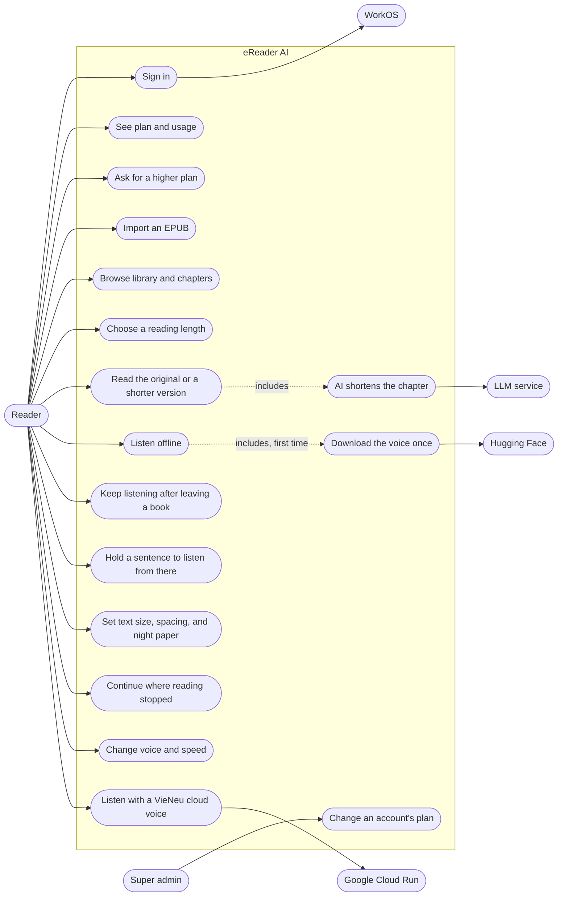
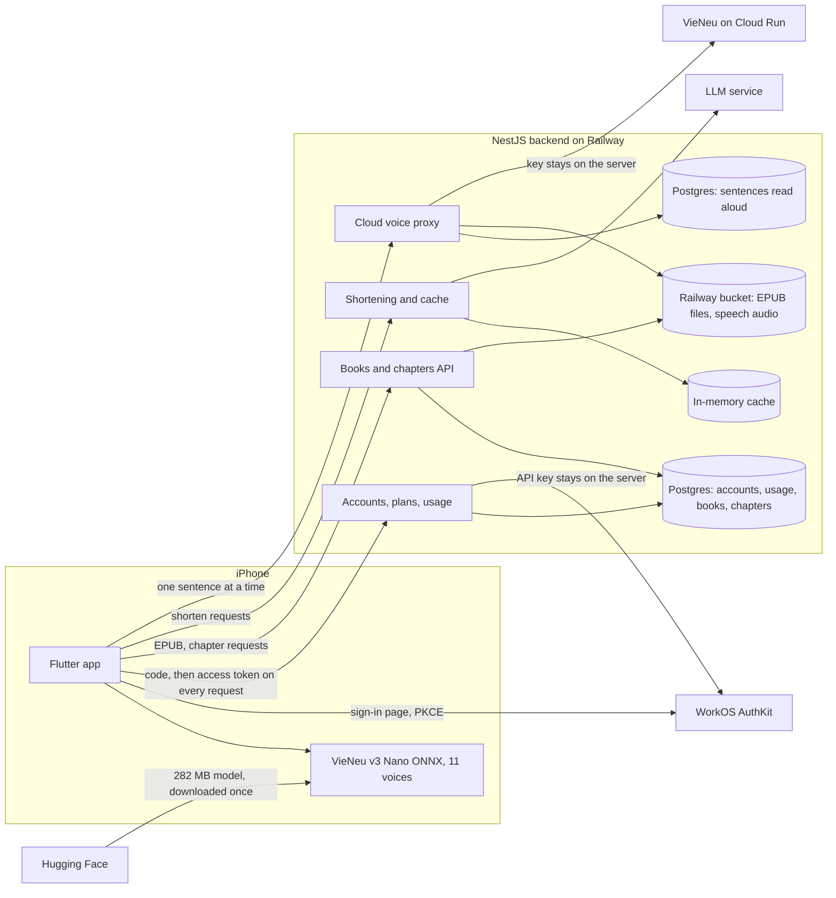

# eReader AI

**English** | [Tiếng Việt](README.vi.md)

An iPhone reading app. Import an EPUB, choose how much time you have, and AI shortens the chapter to fit. To listen instead, the app reads aloud in a Vietnamese voice that runs on the device.

| Library | Chapters | Choose length | Continue | Read | Listen | Keep listening |
|---|---|---|---|---|---|---|
|  |  |  |  |  |  |  |

Screenshots come from the simulator with sample data. Regenerate them with `mobile/tool/capture_screenshots.sh`.

## Use cases



## Where things run



Only the device voices are offline; cloud voices need a connection. Chapter text still comes from the server, so a chapter can't be opened without a connection.

## Today and planned

| | Today | Planned |
|---|---|---|
| Book storage | Books and chapters in PostgreSQL; EPUB files and covers in a Railway bucket. Shortened chapters are cached in memory, so a restart shortens (and charges) them again | Shortened chapters in PostgreSQL |
| EPUB processing | Inside the backend process | Redis and BullMQ queue |
| Accounts | WorkOS sign-in. Plans Free, Plus, Max: 3, 30, 200 books; 10, 100, 500 shortened chapters a month; 30, 300, 1,500 cloud voice minutes a month; EPUB up to 20, 100, 100 MB. Device voices and original text have no limit. The first account to sign in with the verified `SUPER_ADMIN_EMAIL` becomes super admin and grants plans | Payment, account deletion in the app |
| Reading progress | Saved on the device: chapter, version, and paragraph | Sync across devices |
| Text size, spacing, paper | Saved on the device | |
| Voice and speed | Reset each time a chapter opens | Remember the choice |
| Cloud voices | VieNeu-TTS on Google Cloud Run GPU (`voice/`), in the Hạt Dẻ and Trung Tín voices, cloned from short clips in `voice/clips`. The service scales to zero, so the first sentence after a pause waits about a minute. The app keeps about a minute of speech ready, fetching up to 4 sentences at once. A sentence read once is kept (Postgres index, audio in the bucket) and replays without calling the service. Counts against the monthly cloud voice minutes | |
| Platforms | iOS 16 and later | Android not tested yet |

The full design is in [ebook-ai-architecture.md](ebook-ai-architecture.md) (Vietnamese). The Planned column comes from that document and doesn't describe the current code.

## Layout

- `backend/`: NestJS 11, TypeScript. Modules `books`, `processing`, `ai-reading`.
- `mobile/`: Flutter 3.41, `flutter_bloc`. Features `books`, `digest`, `listen`.
- `mobile/tool/build_speech_assets.py`: builds the phoneme table and voice packs in `mobile/assets/speech/`.
- `design/`: HTML mockups. `reader-flow-v2.html` covers the whole flow; `reader-flow-v3.html` is the current reading page.

## Run the backend

Requires Node 24.

```bash
cd backend
cp .env.example .env   # fill in WORKOS_CLIENT_ID, WORKOS_API_KEY, SUPER_ADMIN_EMAIL, LLM_BASE_URL, LLM_API_KEY, LLM_MODEL; VIENEU_URL and VIENEU_API_KEY are optional
npm ci
npm run start:dev
```

The backend listens on port 3000. Change it with `PORT`.

| Method | Path | Purpose |
|---|---|---|
| `POST` | `/books` | Import an EPUB |
| `GET` | `/books` | List books |
| `GET` | `/books/:id/status` | Processing status |
| `GET` | `/books/:id/chapters` | List chapters |
| `GET` | `/chapters/:id` | Original text |
| `POST` | `/chapters/:id/digest` | Shorter version |

## Run the app

Requires Flutter 3.41.4 and Xcode.

```bash
cd mobile
flutter pub get
flutter run --dart-define=API_BASE_URL=http://localhost:3000
```

Without `API_BASE_URL`, the app calls `http://localhost:3000`. The first time you tap Nghe (Listen), the app asks before downloading the 282 MB model to the device.

## Test

```bash
cd backend && npm run build && npm test
cd mobile && flutter analyze && flutter test --concurrency=1
```

The `pre-push` hook runs these for the parts a push touches. Turn it on once per clone with `git config core.hooksPath .githooks`.

Testing with the real model needs a simulator:

```bash
cd mobile
flutter test integration_test/speech_test.dart -d <simulator-id>
```

Integration tests replace the app installed on the simulator, so rebuild the real app afterwards.

## Deploy

The backend runs on Railway from `backend/Dockerfile`. Set `WORKOS_CLIENT_ID`, `WORKOS_API_KEY`, `SUPER_ADMIN_EMAIL`, `LLM_BASE_URL`, `LLM_API_KEY`, `LLM_MODEL`, and optionally `VIENEU_URL`, `VIENEU_API_KEY` in Railway's environment variables, never in the repo.

To build for an iPhone against the deployed backend:

```bash
cd mobile
flutter build ios --release --dart-define=API_BASE_URL=<backend-url>
xcrun devicectl device install app --device <device-id> build/ios/iphoneos/Runner.app
```

## Credits

- Voice model: [VieNeu-TTS v3 Nano](https://huggingface.co/pnnbao-ump/VieNeu-TTS-v3-Nano), Apache-2.0. Downloaded at runtime, not stored in this repo; its 11 preset voices ship as `mobile/assets/speech/voices`. Phonemes come from [sea-g2p](https://pypi.org/project/sea-g2p/), built into a table by `mobile/tool/build_speech_assets.py`.
- ONNX Runtime through `flutter_onnxruntime`, MIT.
