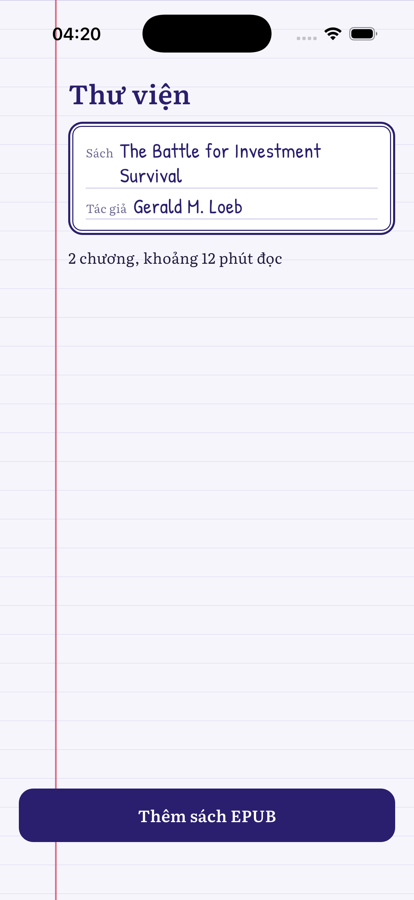
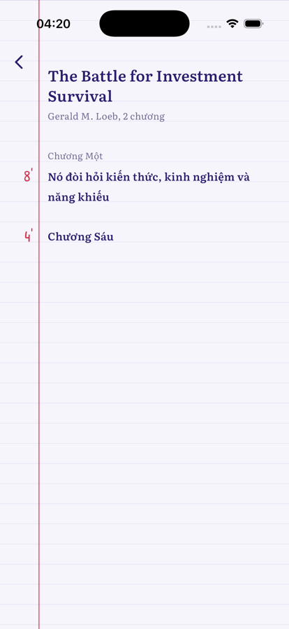
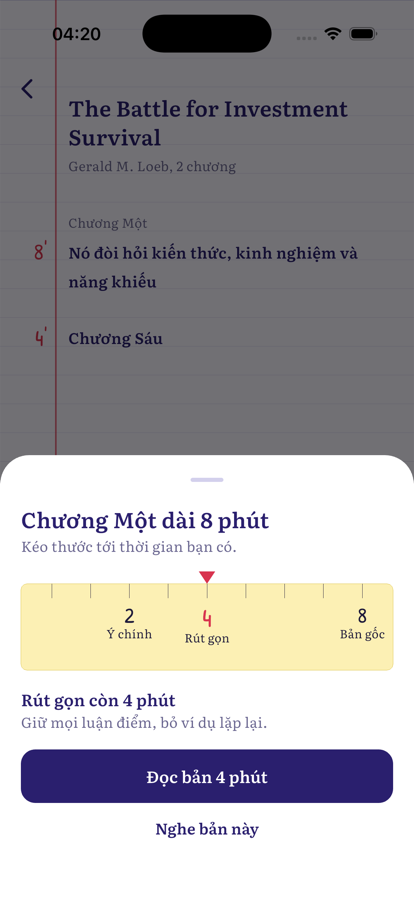
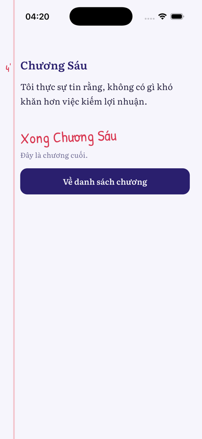
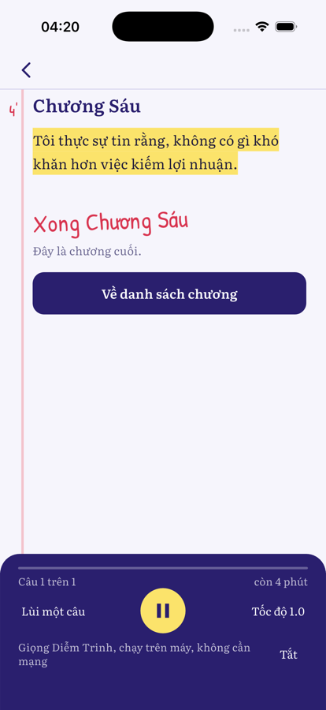
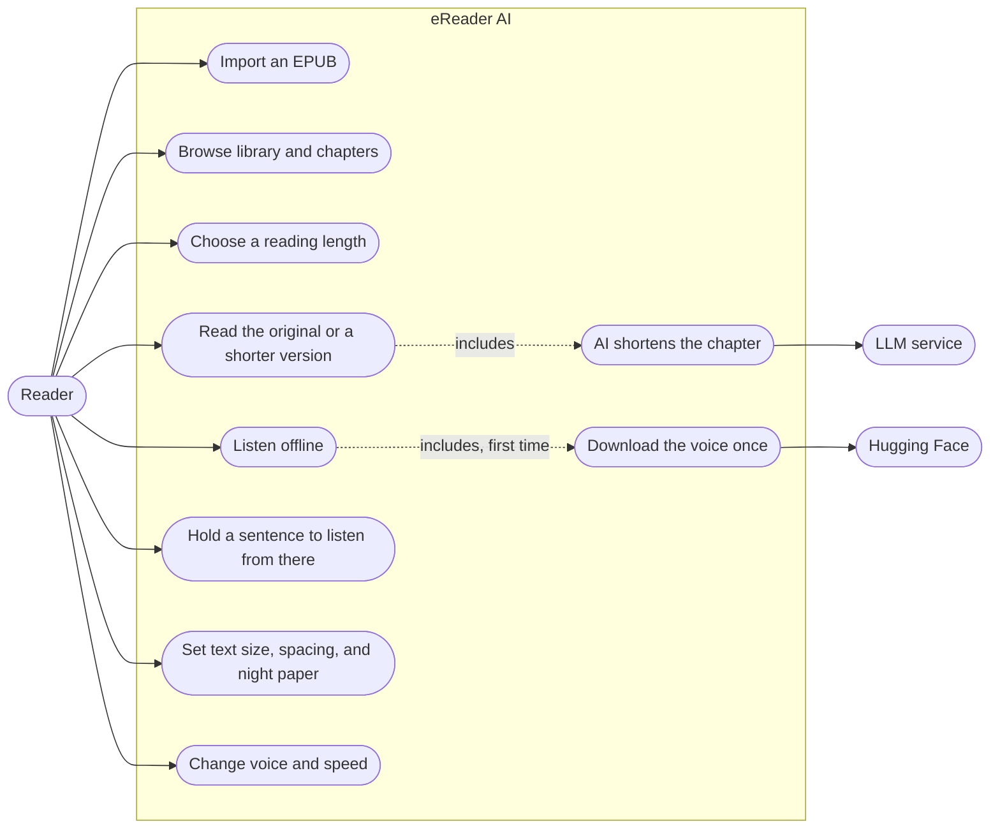
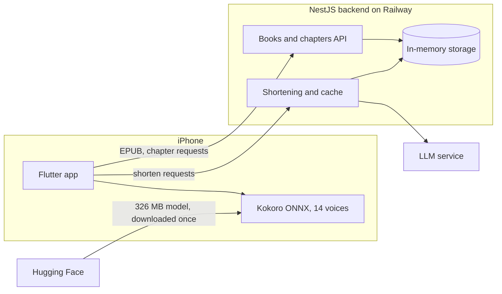

# eReader AI

**English** | [Tiếng Việt](README.vi.md)

An iPhone reading app. Import an EPUB, choose how much time you have, and AI shortens the chapter to fit. To listen instead, the app reads aloud in a Vietnamese voice that runs on the device.

| Library | Chapters | Choose length | Read | Listen |
|---|---|---|---|---|
|  |  |  |  |  |

Screenshots come from the simulator with sample data. Regenerate them with `mobile/tool/capture_screenshots.sh`.

## Use cases



## Where things run



Only the voice is offline. Chapter text still comes from the server, so a chapter can't be opened without a connection.

## Today and planned

| | Today | Planned |
|---|---|---|
| Book storage | In memory, lost when the backend restarts | PostgreSQL and S3 |
| EPUB processing | Inside the backend process | Redis and BullMQ queue |
| Users | One `demo-user`, no sign-in | Sign-in and token budgets |
| Reading progress | Not saved | Save position and resume |
| Text size, spacing, paper | Saved on the device | |
| Voice and speed | Reset each time a chapter opens | Remember the choice |
| Platforms | iOS 16 and later | Android not tested yet |

The full design is in [ebook-ai-architecture.md](ebook-ai-architecture.md) (Vietnamese). The Planned column comes from that document and doesn't describe the current code.

## Layout

- `backend/`: NestJS 11, TypeScript. Modules `books`, `processing`, `ai-reading`.
- `mobile/`: Flutter 3.41, `flutter_bloc`. Features `books`, `digest`, `listen`.
- `mobile/tool/build_speech_assets.py`: builds the phoneme table and voice packs in `mobile/assets/speech/`.
- `design/`: HTML mockups. `reader-flow-v2.html` covers the whole flow; `reader-flow-v3.html` is the current reading page.

## Run the backend

Requires Node 24.

```bash
cd backend
cp .env.example .env   # fill in LLM_BASE_URL, LLM_API_KEY, LLM_MODEL
npm ci
npm run start:dev
```

The backend listens on port 3000. Change it with `PORT`.

| Method | Path | Purpose |
|---|---|---|
| `POST` | `/books` | Import an EPUB |
| `GET` | `/books` | List books |
| `GET` | `/books/:id/status` | Processing status |
| `GET` | `/books/:id/chapters` | List chapters |
| `GET` | `/chapters/:id` | Original text |
| `POST` | `/chapters/:id/digest` | Shorter version |

## Run the app

Requires Flutter 3.41.4 and Xcode.

```bash
cd mobile
flutter pub get
flutter run --dart-define=API_BASE_URL=http://localhost:3000
```

Without `API_BASE_URL`, the app calls `http://localhost:3000`. The first time you tap Nghe (Listen), the app asks before downloading the 326 MB model to the device.

## Test

```bash
cd backend && npm run build && npm test
cd mobile && flutter analyze && flutter test --concurrency=1
```

GitHub Actions runs these on every push to `main` and every pull request.

Testing with the real model needs a simulator:

```bash
cd mobile
flutter test integration_test/speech_test.dart -d <simulator-id>
```

Integration tests replace the app installed on the simulator, so rebuild the real app afterwards.

## Deploy

The backend runs on Railway from `backend/Dockerfile`. Set `LLM_BASE_URL`, `LLM_API_KEY`, and `LLM_MODEL` in Railway's environment variables, never in the repo.

To build for an iPhone against the deployed backend:

```bash
cd mobile
flutter build ios --release --dart-define=API_BASE_URL=<backend-url>
xcrun devicectl device install app --device <device-id> build/ios/iphoneos/Runner.app
```

## Credits

- Voice model: [Kokoro-Vietnamese](https://github.com/iamdinhthuan/Kokoro-Vietnamese), Apache-2.0. Downloaded at runtime, not stored in this repo.
- ONNX Runtime through `flutter_onnxruntime`, MIT.
