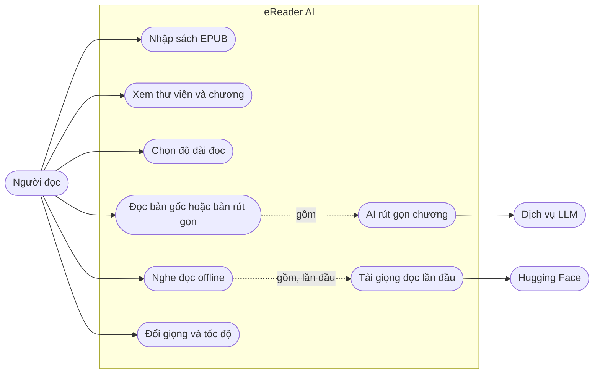
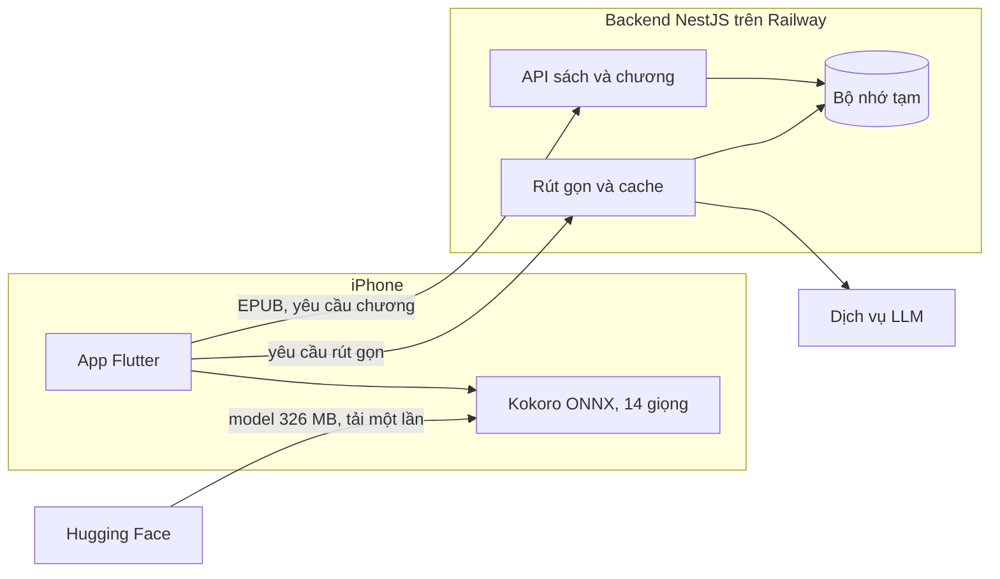

# eReader AI

[English](README.md) | **Tiếng Việt**

Ứng dụng đọc sách trên iPhone. Nhập file EPUB, chọn thời gian bạn có, AI rút gọn chương cho vừa thời gian đó. Muốn nghe thì app đọc to bằng giọng tiếng Việt chạy ngay trên máy.

| Thư viện | Chương | Chọn độ dài | Nghe |
|---|---|---|---|
|  |  |  |  |

Ảnh chụp từ simulator với dữ liệu mẫu. Tạo lại bằng `mobile/tool/capture_screenshots.sh`.

## Use case



## Dữ liệu chạy ở đâu



Chỉ giọng đọc là offline. Nội dung chương vẫn lấy từ server, nên không có mạng thì không mở được chương.

## Hiện có và dự kiến

| | Hiện có | Dự kiến |
|---|---|---|
| Lưu sách | Bộ nhớ tạm, mất khi backend restart | PostgreSQL và S3 |
| Xử lý EPUB | Trong tiến trình backend | Hàng đợi Redis và BullMQ |
| Người dùng | Một `demo-user`, chưa có đăng nhập | Đăng nhập và hạn mức token |
| Tiến độ đọc | Chưa lưu | Lưu vị trí và đọc tiếp |
| Giọng và tốc độ | Về mặc định mỗi lần mở chương | Ghi nhớ lựa chọn |
| Nền tảng | iOS 16 trở lên | Android chưa kiểm thử |

Thiết kế đầy đủ nằm ở [ebook-ai-architecture.md](ebook-ai-architecture.md). Cột "Dự kiến" lấy từ tài liệu đó, không phải mô tả code hiện tại.

## Cấu trúc

- `backend/`: NestJS 11, TypeScript. Module `books`, `processing`, `ai-reading`.
- `mobile/`: Flutter 3.41, `flutter_bloc`. Feature `books`, `digest`, `listen`.
- `mobile/tool/build_speech_assets.py`: tạo bảng phiên âm và voice pack trong `mobile/assets/speech/`.
- `design/`: mockup HTML. Bản đang dùng là `reader-flow-v2.html`.

## Chạy backend

Cần Node 24.

```bash
cd backend
cp .env.example .env   # điền LLM_BASE_URL, LLM_API_KEY, LLM_MODEL
npm ci
npm run start:dev
```

Backend nghe ở cổng 3000, đổi bằng biến `PORT`.

| Phương thức | Đường dẫn | Việc |
|---|---|---|
| `POST` | `/books` | Nhập EPUB |
| `GET` | `/books` | Danh sách sách |
| `GET` | `/books/:id/status` | Trạng thái xử lý |
| `GET` | `/books/:id/chapters` | Danh sách chương |
| `GET` | `/chapters/:id` | Nội dung gốc |
| `POST` | `/chapters/:id/digest` | Bản rút gọn |

## Chạy app

Cần Flutter 3.41.4 và Xcode.

```bash
cd mobile
flutter pub get
flutter run --dart-define=API_BASE_URL=http://localhost:3000
```

Không truyền `API_BASE_URL` thì app gọi `http://localhost:3000`. Lần đầu bấm Nghe, app hỏi rồi tải model 326 MB vào máy.

## Kiểm thử

```bash
cd backend && npm run build && npm test
cd mobile && flutter analyze && flutter test --concurrency=1
```

GitHub Actions chạy các lệnh trên ở mỗi push lên `main` và mỗi pull request.

Test với model thật cần simulator:

```bash
cd mobile
flutter test integration_test/speech_test.dart -d <simulator-id>
```

Integration test ghi đè app đã cài trên simulator, nên phải build lại app thật sau khi chạy.

## Deploy

Backend chạy trên Railway từ `backend/Dockerfile`. Đặt `LLM_BASE_URL`, `LLM_API_KEY`, `LLM_MODEL` trong biến môi trường của Railway, không đưa vào repo.

Bản iPhone trỏ vào backend đã deploy:

```bash
cd mobile
flutter build ios --release --dart-define=API_BASE_URL=<backend-url>
xcrun devicectl device install app --device <device-id> build/ios/iphoneos/Runner.app
```

## Nguồn tài nguyên

- Model giọng đọc: [Kokoro-Vietnamese](https://github.com/iamdinhthuan/Kokoro-Vietnamese), giấy phép Apache-2.0. Tải từ Hugging Face khi chạy, không nằm trong repo.
- ONNX Runtime qua `flutter_onnxruntime`, giấy phép MIT.
