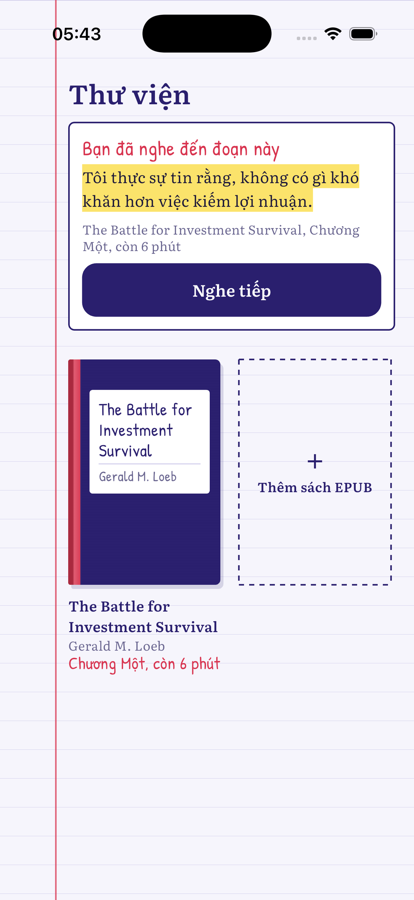
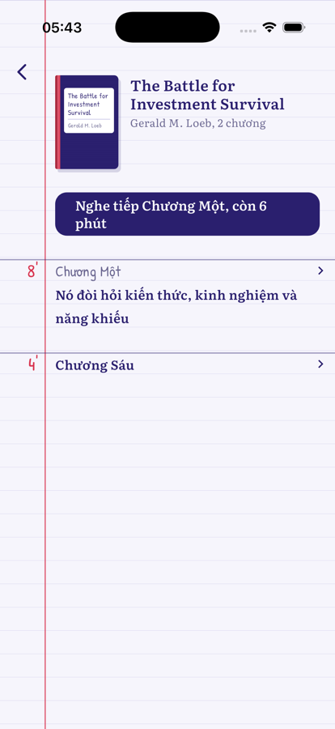
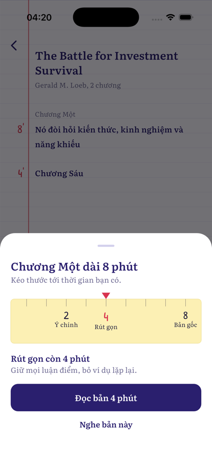
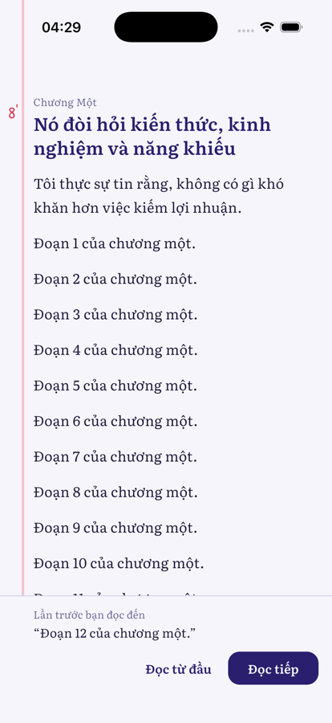
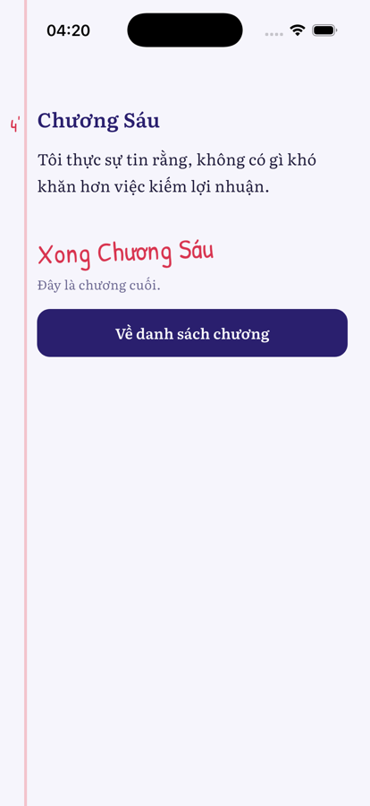
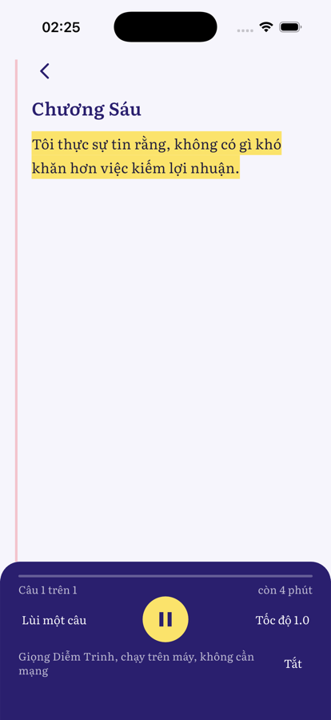
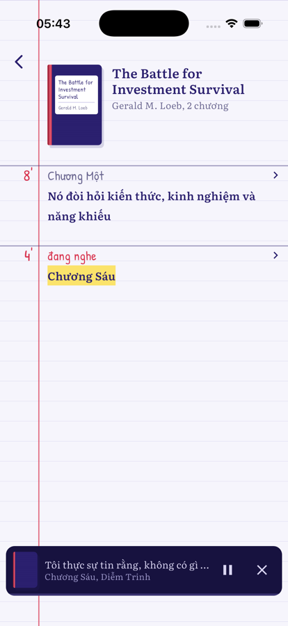
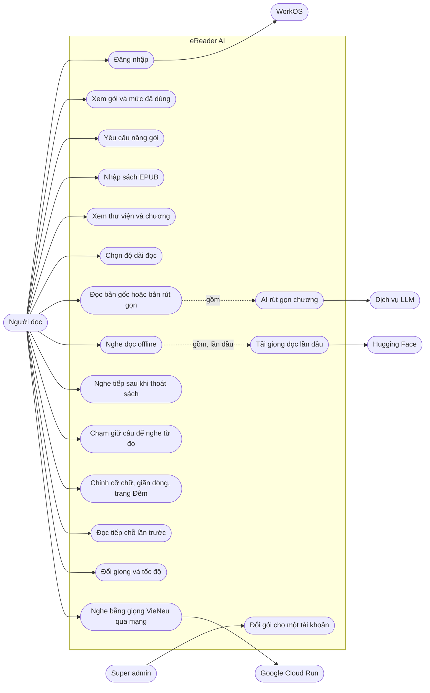
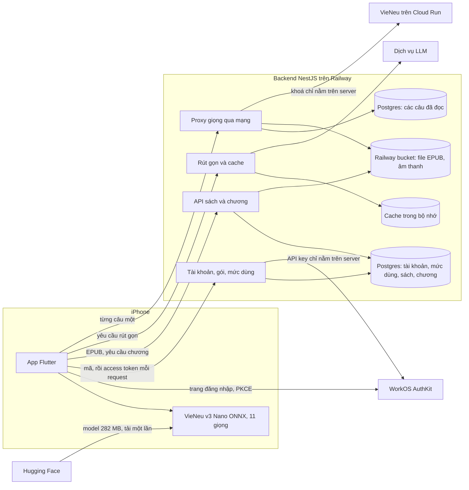

# eReader AI

[English](README.md) | **Tiếng Việt**

Ứng dụng đọc sách trên iPhone. Nhập file EPUB, chọn thời gian bạn có, AI rút gọn chương cho vừa thời gian đó. Muốn nghe thì app đọc to bằng giọng tiếng Việt chạy ngay trên máy.

| Thư viện | Chương | Chọn độ dài | Đọc tiếp | Đọc | Nghe | Vẫn nghe |
|---|---|---|---|---|---|---|
|  |  |  |  |  |  |  |

Ảnh chụp từ simulator với dữ liệu mẫu. Tạo lại bằng `mobile/tool/capture_screenshots.sh`.

## Use case



## Dữ liệu chạy ở đâu



Chỉ giọng trên máy là offline; giọng qua mạng cần mạng. Nội dung chương vẫn lấy từ server, nên không có mạng thì không mở được chương.

## Hiện có và dự kiến

| | Hiện có | Dự kiến |
|---|---|---|
| Lưu sách | Sách và chương trong PostgreSQL; file EPUB và ảnh bìa trong Railway bucket. Chương rút gọn được cache trong bộ nhớ, nên sau khi restart sẽ rút gọn (và tính lượt) lại | Chương rút gọn trong PostgreSQL |
| Xử lý EPUB | Trong tiến trình backend | Hàng đợi Redis và BullMQ |
| Tài khoản | Đăng nhập qua WorkOS. Gói Free, Plus, Max: 3, 30, 200 cuốn; 10, 100, 500 chương rút gọn mỗi tháng; 30, 300, 1.500 phút giọng qua mạng mỗi tháng; file EPUB tối đa 20, 100, 100 MB. Giọng trên máy và bản gốc không giới hạn. Tài khoản đầu tiên đăng nhập bằng `SUPER_ADMIN_EMAIL` đã xác minh thành super admin và duyệt gói | Thanh toán, xoá tài khoản trong app |
| Tiến độ đọc | Lưu trên máy: chương, bản đọc và đoạn | Đồng bộ giữa các máy |
| Cỡ chữ, giãn dòng, trang giấy | Lưu trên máy | |
| Giọng và tốc độ | Về mặc định mỗi lần mở chương | Ghi nhớ lựa chọn |
| Giọng qua mạng | VieNeu-TTS trên Cloud Run GPU của Google (`voice/`), có giọng Hạt Dẻ và Trung Tín, nhân bản từ các đoạn mẫu ngắn trong `voice/clips`. Service tự tắt khi rảnh, nên câu đầu sau khi nghỉ chờ khoảng một phút. App luôn giữ sẵn khoảng 1 phút âm thanh, tải tối đa 4 câu cùng lúc. Câu đã đọc một lần được lưu lại (mục lục trong Postgres, âm thanh trong bucket) và phát lại không cần gọi service. Tính vào số phút giọng qua mạng hằng tháng | |
| Nền tảng | iOS 16 trở lên | Android chưa kiểm thử |

Thiết kế đầy đủ nằm ở [ebook-ai-architecture.md](ebook-ai-architecture.md). Cột "Dự kiến" lấy từ tài liệu đó, không phải mô tả code hiện tại.

## Cấu trúc

- `backend/`: NestJS 11, TypeScript. Module `books`, `processing`, `ai-reading`.
- `mobile/`: Flutter 3.41, `flutter_bloc`. Feature `books`, `digest`, `listen`.
- `mobile/tool/build_speech_assets.py`: tạo bảng phiên âm và voice pack trong `mobile/assets/speech/`.
- `design/`: mockup HTML. `reader-flow-v2.html` cho cả luồng; `reader-flow-v3.html` là màn đọc hiện tại.

## Chạy backend

Cần Node 24.

```bash
cd backend
cp .env.example .env   # điền WORKOS_CLIENT_ID, WORKOS_API_KEY, SUPER_ADMIN_EMAIL, LLM_BASE_URL, LLM_API_KEY, LLM_MODEL; VIENEU_URL và VIENEU_API_KEY không bắt buộc
npm ci
npm run start:dev
```

Backend nghe ở cổng 3000, đổi bằng biến `PORT`.

| Phương thức | Đường dẫn | Việc |
|---|---|---|
| `POST` | `/books` | Nhập EPUB |
| `GET` | `/books` | Danh sách sách |
| `GET` | `/books/:id/status` | Trạng thái xử lý |
| `GET` | `/books/:id/chapters` | Danh sách chương |
| `GET` | `/chapters/:id` | Nội dung gốc |
| `POST` | `/chapters/:id/digest` | Bản rút gọn |

## Chạy app

Cần Flutter 3.41.4 và Xcode.

```bash
cd mobile
flutter pub get
flutter run --dart-define=API_BASE_URL=http://localhost:3000
```

Không truyền `API_BASE_URL` thì app gọi `http://localhost:3000`. Lần đầu bấm Nghe, app hỏi rồi tải model 282 MB vào máy.

## Kiểm thử

```bash
cd backend && npm run build && npm test
cd mobile && flutter analyze && flutter test --concurrency=1
```

Hook `pre-push` chạy các lệnh trên cho những phần mà lần push thay đổi. Bật một lần cho mỗi clone bằng `git config core.hooksPath .githooks`.

Test với model thật cần simulator:

```bash
cd mobile
flutter test integration_test/speech_test.dart -d <simulator-id>
```

Integration test ghi đè app đã cài trên simulator, nên phải build lại app thật sau khi chạy.

## Deploy

Backend chạy trên Railway từ `backend/Dockerfile`. Đặt `WORKOS_CLIENT_ID`, `WORKOS_API_KEY`, `SUPER_ADMIN_EMAIL`, `LLM_BASE_URL`, `LLM_API_KEY`, `LLM_MODEL`, và nếu dùng giọng qua mạng thì `VIENEU_URL`, `VIENEU_API_KEY`, trong biến môi trường của Railway, không đưa vào repo.

Bản iPhone trỏ vào backend đã deploy:

```bash
cd mobile
flutter build ios --release --dart-define=API_BASE_URL=<backend-url>
xcrun devicectl device install app --device <device-id> build/ios/iphoneos/Runner.app
```

## Nguồn tài nguyên

- Model giọng đọc: [VieNeu-TTS v3 Nano](https://huggingface.co/pnnbao-ump/VieNeu-TTS-v3-Nano), giấy phép Apache-2.0. Tải từ Hugging Face khi chạy, không nằm trong repo; 11 giọng có sẵn đi kèm trong `mobile/assets/speech/voices`. Âm vị lấy từ [sea-g2p](https://pypi.org/project/sea-g2p/), dựng thành bảng bằng `mobile/tool/build_speech_assets.py`.
- ONNX Runtime qua `flutter_onnxruntime`, giấy phép MIT.
