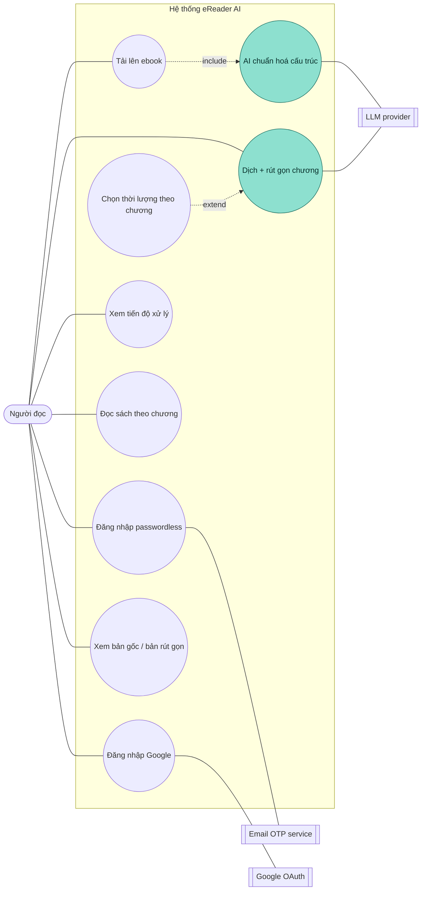
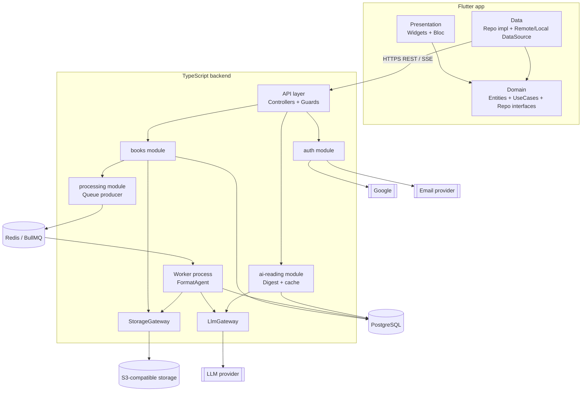
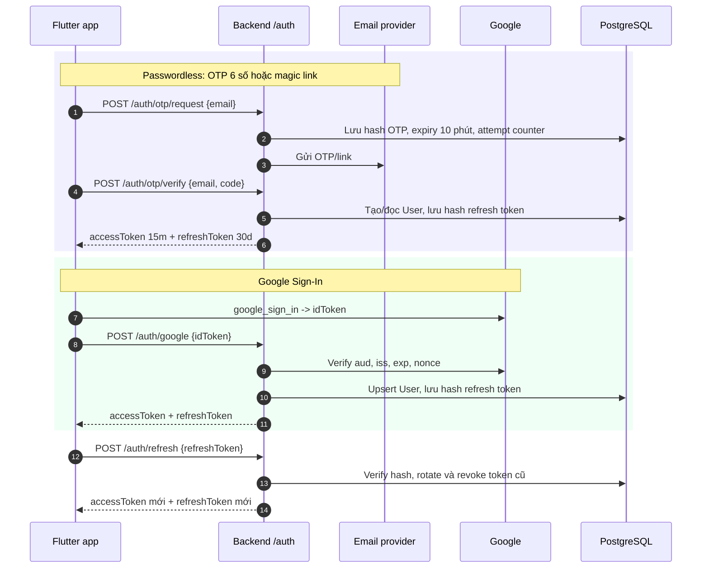
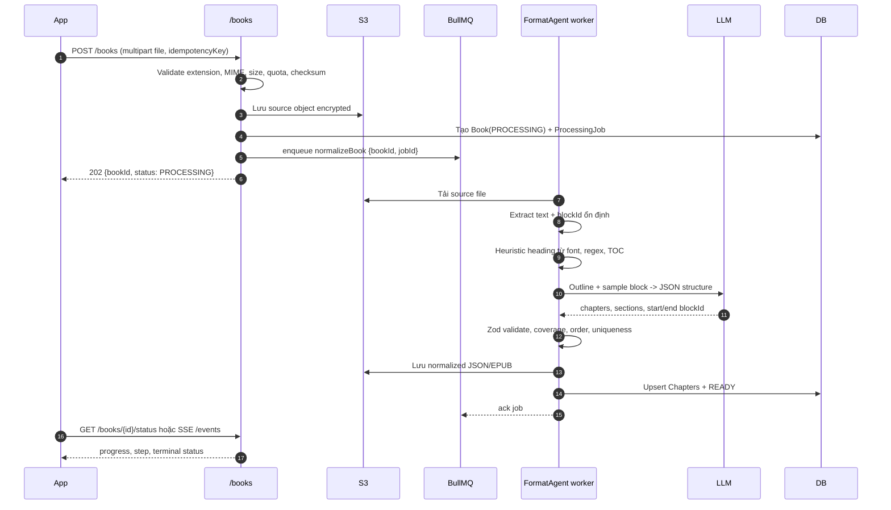
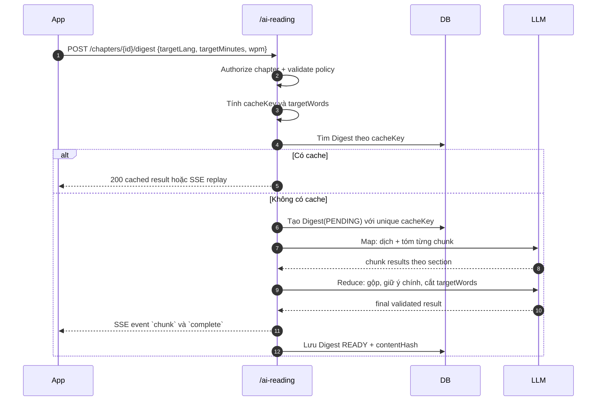
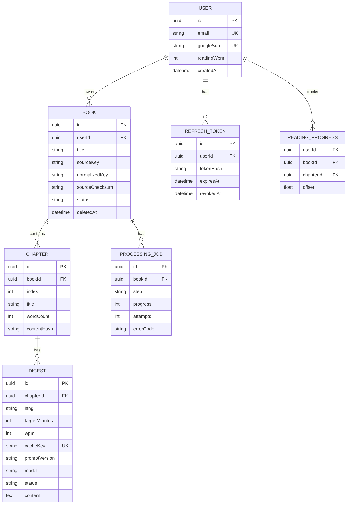

# eReader AI — Tài liệu kiến trúc

> Đây là thiết kế đích, chưa phải mô tả code hiện tại. Xem phần "Hiện có và dự kiến" trong [README](README.md).

> Trạng thái: **greenfield / architecture baseline**  
> Mobile: Flutter + `flutter_bloc`  
> Backend: TypeScript + NestJS  
> Ngôn ngữ giải thích: tiếng Việt; tên module/class/API giữ tiếng Anh.

## 0. Quyết định đã chốt

| Chủ đề | Quyết định | Lý do / ràng buộc |
|---|---|---|
| Mobile state | `flutter_bloc` | Mỗi use case có boundary rõ, dễ test bằng `bloc_test`; có thể thay bằng Riverpod nếu giữ nguyên domain boundary. |
| Backend | NestJS + TypeScript | Module, guard, queue worker và dependency injection phù hợp với hệ thống nhiều boundary. |
| Chuẩn hoá ebook | Bất đồng bộ qua Redis + BullMQ | Upload trả `202`; worker có thể retry và không giữ request HTTP mở. |
| AI cấu trúc | LLM chỉ trả vị trí block, title, heading level | Không cho LLM viết lại nội dung gốc; giảm hallucination và chi phí. |
| Dịch/rút gọn | Map → Reduce, stream SSE | Chunk lớn được xử lý độc lập; reduce giữ bố cục và cắt về số từ mục tiêu. |
| Cache | PostgreSQL, key có `promptVersion` và `model` | Đổi prompt/model phải tự vô hiệu cache cũ. |
| Upload mặc định | 100 MB/file, 500 MB/user/ngày | Giới hạn này là policy cấu hình, không hard-code ở controller. |
| LLM budget | 100k input tokens/user/ngày; 10k/job | Vượt quota trả lỗi có mã ổn định; admin có thể thay theo plan. |
| Retry | Tối đa 3 lần, exponential backoff + jitter | Job lỗi cuối cùng vào dead-letter queue (DLQ), không tạo chapter trùng. |
| SSE reconnect | `id`, `Last-Event-ID`, heartbeat 15s, fallback polling | Client mất mạng vẫn tiếp tục nhận từ event cuối đã biết. |
| Privacy | Mã hoá transit/at rest; không dùng nội dung user để train mặc định | Xoá sách phải xoá object, chapter, digest và job liên quan theo policy. |

Các giá trị trên là baseline. Khi thay đổi, cập nhật bảng này và tăng `architectureVersion` nếu thay đổi contract.

## 1. Tóm tắt hệ thống

eReader AI giúp người đọc:

1. Đăng nhập passwordless bằng email OTP/magic link hoặc Google Sign-In.
2. Upload ebook (`EPUB`, `PDF`, `TXT`). Hệ thống trích xuất và chuẩn hoá mục lục/chương bất đồng bộ.
3. Đọc nội dung gốc theo chương.
4. Chọn ngôn ngữ và thời lượng (bản gốc, khoảng 50%, khoảng 25% của chương) để dịch + rút gọn theo yêu cầu.
5. Xem bản gốc hoặc bản dịch/rút gọn; kết quả được cache.

### 1.1. Nguyên tắc bất biến

- Nội dung gốc là source of truth. AI không được thay thế block văn bản.
- Domain layer không import framework, Flutter, Dio, database hoặc SDK provider.
- Controller chỉ parse/authorize/request service; không gọi repository hoặc LLM SDK trực tiếp.
- Mọi output LLM đi qua schema validation trước khi ghi DB hoặc gửi client.
- Job và endpoint digest phải idempotent theo `bookId`, `cacheKey`, `jobId`.
- Không log nội dung sách, prompt chứa nội dung sách, access token hoặc token LLM.

## 2. Use case diagram

Các ô màu xanh ngọc là use case có AI tham gia.



| ID | Use case | Tiền điều kiện | Kết quả |
|---|---|---|---|
| UC1 | Đăng nhập passwordless | Có email | Access token 15 phút + refresh token 30 ngày |
| UC2 | Đăng nhập Google | Có Google `idToken` hợp lệ | Access token + refresh token |
| UC3 | Tải lên ebook | Đã đăng nhập, file hợp lệ | `Book.PROCESSING`, tạo normalize job |
| UC4 | AI chuẩn hoá cấu trúc | Job từ UC3 | `Chapter`/`Section`, `Book.READY` hoặc `FAILED` |
| UC5 | Xem tiến độ | Có `bookId` của user | Phần trăm, step, lỗi nếu có |
| UC6 | Đọc theo chương | Book `READY` | Nội dung block gốc |
| UC7 | Dịch + rút gọn | Có quyền đọc chapter | Kết quả dịch, có thể stream SSE |
| UC8 | Chọn thời lượng | Đang ở UC7 | `targetMinutes` thuộc policy |
| UC9 | So sánh | Có digest | Chuyển bản gốc / bản rút gọn |

## 3. Kiến trúc tổng thể



### 3.1. Dependency rules

**Flutter**

- `presentation -> domain <- data`.
- `domain` chỉ chứa Dart thuần: entity, failure, repository interface, use case.
- `data` map DTO/model sang entity; không để JSON leak vào presentation.
- `presentation` chỉ gọi use case thông qua Bloc/event/state.

**Backend**

- Controller gọi service; service gọi repository, queue hoặc `LlmGateway`.
- `LlmGateway` là interface duy nhất mà application code dùng để gọi model.
- Worker chạy process riêng, chỉ nhận job từ queue; không chia sẻ request context.
- `StorageGateway` che S3 SDK; `Repository` che Prisma/TypeORM.

## 4. Xác thực và phiên



### 4.1. Security policy

- Rate-limit OTP theo `email + IP`; thêm global IP limit và cooldown sau nhiều lần sai.
- Chỉ lưu hash OTP/refresh token; không lưu code/token nguyên bản.
- JWT access token ngắn hạn; refresh token rotation và revoke theo `userId`, device/session.
- Flutter lưu refresh token bằng `flutter_secure_storage`; không lưu trong shared preferences.
- Google token phải kiểm tra `aud`, `iss`, `exp`, `nonce`; không tin claim từ client.
- Log chỉ dùng `requestId`, `userId` đã băm hoặc ID nội bộ; redact email và token.

## 5. Chuẩn hoá ebook: UC3 → UC4



### 5.1. FormatAgent pipeline

1. **Ingest**: kiểm tra MIME thực tế, checksum, file signature; reject archive bomb hoặc file hỏng.
2. **Extract**: chuyển EPUB/PDF/TXT thành `Block[]`, mỗi block có `blockId`, text, metadata tối thiểu.
3. **Heuristic**: đọc TOC/font/regex (`Chapter`, số thứ tự, heading style) để tạo candidate outline.
4. **LLM structure**: gửi outline và mẫu block theo cửa sổ có overlap; LLM chỉ được chọn block có sẵn.
5. **Validate**: parse schema; kiểm tra block tồn tại, thứ tự tăng, không trùng, coverage đủ.
6. **Merge**: gộp cửa sổ, giải quyết overlap bằng `blockId` và ưu tiên candidate có điểm tin cậy cao hơn.
7. **Persist**: upsert theo `(bookId, index)` trong transaction; ghi normalized object trước khi `READY`.

Nếu LLM schema sai: retry tối đa 2 lần với cùng `jobId`, sau đó fallback heuristic. Nếu fallback không đạt coverage, book chuyển `FAILED` và không tạo chapter một phần.

### 5.2. Schema

```ts
type NormalizedBook = {
  bookId: string;
  language: string;
  chapters: {
    id: string;
    index: number;
    title: string;
    startBlockId: string;
    endBlockId: string;
    wordCount: number;
    sections: {
      title: string;
      level: 2 | 3;
      startBlockId: string;
    }[];
  }[];
};
```

### 5.3. Job policy

- Queue name: `ebook-normalization`; DLQ name: `ebook-normalization.dlq`.
- Retry: `attempts=3`, delay exponential (`30s`, `2m`, `10m`) + jitter.
- `jobId = normalize:${bookId}:${sourceChecksum}` để enqueue lại không nhân đôi.
- Worker heartbeat/lock timeout phải lớn hơn thời gian parse + LLM window; stalled job được BullMQ recover.
- Mỗi trạng thái ghi `step`, `progress`, `updatedAt`, `errorCode`; không ghi raw exception có nội dung sách.
- DLQ cần admin re-drive; re-drive dùng cùng idempotency key.

## 6. Dịch + rút gọn theo thời lượng



### 6.1. Quy tắc tính thời lượng

- `targetWords = targetMinutes * wpm`; mặc định `wpm=200` cho tiếng Việt.
- App đề xuất thời lượng theo độ dài chương: bản gốc, khoảng 50%, khoảng 25% (tối thiểu 2 phút). Chương dưới 5 phút mở thẳng bản gốc. Backend nhận `targetMinutes` nguyên trong khoảng 1–240.
- Nếu `chapter.wordCount <= targetWords`: chỉ dịch, không rút gọn.
- Nếu cần rút gọn: chia theo section, phân bổ quota theo tỷ lệ word count; không làm mất title/ý chính.
- Giữ tên riêng, số liệu, phủ định, quan hệ nhân quả; không bịa phần thiếu.
- Kết quả phải có `sourceChapterId`, `sourceContentHash`, `promptVersion`, `model`.

### 6.2. Cache và đồng thời

```text
cacheKey = sha256(
  chapterContentHash + targetLang + targetMinutes + wpm + promptVersion + model
)
```

- Unique index trên `Digest.cacheKey`.
- Hai request đồng thời cùng key dùng một lock ngắn hoặc cùng bản ghi `PENDING`; request sau subscribe/replay, không gọi LLM lần hai.
- Nếu request bị huỷ, server dừng stream nhưng có thể hoàn tất và lưu cache nếu policy cho phép.
- Cache hit không cần gọi LLM; cache cũ không dùng khi `promptVersion` hoặc `model` đổi.

## 7. SSE contract và reconnect

### 7.1. Event format

```text
id: 42
event: chunk
data: {"digestId":"...","sectionIndex":2,"text":"..."}

id: 43
event: complete
data: {"digestId":"...","cacheKey":"...","wordCount":1980}
```

- Heartbeat: comment event mỗi 15 giây.
- Event ID tăng đơn điệu theo digest; server lưu event cần replay trong thời gian TTL.
- Client gửi `Last-Event-ID` khi reconnect; server replay từ event kế tiếp.
- Nếu event đã hết TTL: server trả `409 REPLAY_WINDOW_EXPIRED`; client gọi `GET /digests/{id}` hoặc bắt đầu request mới.
- Event terminal: `complete` hoặc `error`; client đóng stream sau terminal.
- Nếu proxy/client không hỗ trợ SSE, dùng polling `GET /chapters/{id}/digest/{cacheKey}`.

## 8. Mô hình dữ liệu



### 8.1. Data lifecycle và privacy

- Source và normalized object dùng server-side encryption; DB bật encryption at rest và backup encryption.
- Object key không chứa email hoặc title chưa sanitize; dùng random UUID prefix.
- Nội dung gửi LLM qua TLS; provider phải có policy không train dữ liệu và retention phù hợp.
- Mặc định giữ sách đến khi user xoá; digest/cache xoá cùng chapter hoặc theo TTL cấu hình.
- Xoá sách là workflow bất đồng bộ: đánh dấu `DELETING`, revoke job, xoá object, xoá row con, rồi `DELETED`.
- Backup purge tuân theo retention; API trả trạng thái xoá, không tuyên bố xoá vật lý tức thời nếu còn trong backup.

## 9. Cấu trúc thư mục dự kiến

```text
ereader-ai/
  ebook-ai-architecture.md
  mobile/
    lib/
      core/                 # DI, Dio, refresh interceptor, error, theme
      features/
        auth/
          domain/           # entities, repository contracts, use cases
          data/             # freezed/json models, data sources, repo impl
          presentation/     # Bloc, pages, widgets
        library/             # upload, list, processing status
        reader/              # chapter reading, ReaderBloc
        digest/              # target settings, SSE, DigestBloc
  backend/
    src/
      modules/
        auth/                # OTP, Google, JWT, refresh rotation
        books/               # upload, list, status, chapters
        processing/          # producer, FormatAgent, extractors
        ai-reading/          # digest service, prompt templates, cache
      shared/
        llm/                 # LlmGateway + provider adapters
        storage/             # StorageGateway + S3 adapter
        db/                  # Prisma/TypeORM client, repositories
        security/            # rate limit, redaction, authorization
    src/worker.ts            # BullMQ worker entrypoint
```

## 10. API contract

| Method | Path | Mô tả |
|---|---|---|
| POST | `/auth/otp/request` | Gửi OTP/link; luôn trả response chống email enumeration |
| POST | `/auth/otp/verify` | Xác thực OTP, cấp token |
| POST | `/auth/google` | Verify Google `idToken`, cấp token |
| POST | `/auth/refresh` | Rotate refresh token |
| POST | `/books` | Multipart upload, trả `202` |
| GET | `/books` | Danh sách sách của user |
| GET | `/books/:id/status` | Trạng thái normalize |
| GET | `/books/:id/events` | SSE tiến độ normalize |
| GET | `/books/:id/chapters` | Mục lục đã chuẩn hoá |
| GET | `/chapters/:id` | Nội dung chapter gốc |
| POST | `/chapters/:id/digest` | Tạo hoặc stream digest SSE |
| GET | `/digests/:id` | Lấy digest đã hoàn tất / polling fallback |
| DELETE | `/books/:id` | Bắt đầu workflow xoá sách |

### 10.1. Error contract

```json
{
  "error": {
    "code": "LLM_QUOTA_EXCEEDED",
    "message": "Daily AI quota exceeded",
    "requestId": "req_01J..."
  }
}
```

`message` không chứa nội dung sách, stack trace, prompt hoặc provider secret. Client dựa vào `code`, không parse message.

### 10.2. Upload validation

- Accept extension và MIME thực tế: EPUB, PDF, TXT; reject mismatch.
- Max 100 MB/file, max 500 MB/user/day; kiểm tra quota trước khi upload và sau khi stream.
- Giới hạn số trang/block để chống resource exhaustion; reject encrypted/password-protected file nếu extractor không hỗ trợ.
- Tính checksum để deduplicate và idempotency; quét malware nếu hạ tầng có scanner.

## 11. LLM gateway và ngân sách

```ts
interface LlmGateway {
  complete<T>(request: {
    promptVersion: string;
    model: string;
    input: unknown;
    outputSchema: unknown;
    maxInputTokens: number;
    maxOutputTokens: number;
    signal?: AbortSignal;
  }): Promise<{ value: T; usage: { inputTokens: number; outputTokens: number } }>;
}
```

- Provider adapter map lỗi provider thành `LlmError` ổn định: timeout, rate limit, invalid output, quota.
- `outputSchema` được validate bằng Zod ngay trong gateway hoặc ngay sau gateway.
- Không gửi toàn bộ sách nếu window/chunk đủ; redact metadata không cần thiết.
- Budget guard trước call: kiểm tra user/day, request, model max output; ghi usage aggregate, không ghi token text.
- Model routing: heuristic/cheap model cho outline; model chất lượng cao hơn chỉ dùng reduce khi cần.
- Prompt template nằm trong `modules/*/prompts`; mọi thay đổi tăng `promptVersion`.

## 12. Observability và vận hành

Metrics không chứa nội dung:

- `books_upload_total`, `normalize_job_duration_ms`, `normalize_failure_total` theo `errorCode`.
- `digest_cache_hit_ratio`, `digest_llm_latency_ms`, `digest_stream_disconnect_total`.
- `llm_input_tokens_total`, `llm_output_tokens_total`, `llm_cost_estimate` theo model/tenant.
- Queue depth, oldest job age, retry count, DLQ count.

Tracing dùng `requestId`/`traceId`; propagation qua API → queue job → worker. Log structured JSON, redact token/email/content.

## 13. Testing strategy

### Flutter

- Mỗi use case có unit test cho success, validation failure, network failure.
- Mỗi Bloc có `bloc_test`: initial/loading/success/error, reconnect SSE, cache hit.
- Data source test JSON/schema; repository test mapping DTO ↔ entity.

### Backend

- Unit test `FormatAgent` với fixture block và fixture LLM output hợp lệ/sai schema.
- Property test coverage: block trước/sau chuẩn hoá bằng nhau, thứ tự không giảm, không duplicate.
- Contract test controller cho auth, upload, digest, SSE event shape.
- Integration test PostgreSQL/Redis/S3 emulator; retry, stalled job, DLQ, idempotent re-drive.
- Security test: authorization cross-user, rate limit OTP, upload bomb, token rotation/reuse.

## 14. Acceptance checklist

- [ ] Upload trả `202` và không giữ request đến khi AI xong.
- [ ] Worker retry tối đa 3 lần; job chạy lại không tạo chapter trùng.
- [ ] LLM structure output bị reject nếu block thiếu/trùng/sai thứ tự.
- [ ] Fallback heuristic không làm mất block; failure có `errorCode` ổn định.
- [ ] Digest cache key chứa content hash, lang, minutes, wpm, prompt version, model.
- [ ] Chapter ngắn hơn target chỉ dịch, không rút gọn.
- [ ] SSE có event ID, heartbeat, replay từ `Last-Event-ID`, terminal event.
- [ ] Không log nội dung sách hoặc token.
- [ ] Xoá sách xoá/thu hồi source, normalized file, chapter, digest, job theo policy.
- [ ] Flutter domain không import Flutter/Dio/data; backend controller không gọi LLM SDK.

## 15. Quy tắc cho AI coding agent

1. Đọc tài liệu này trước khi sửa code.
2. Tìm implementation/utility hiện có trước khi thêm logic; không nhân bản rule, validator hoặc mapper.
3. Giữ ranh giới layer; nếu cần phá ranh giới, ghi ADR trước.
4. Mọi output LLM phải parse schema; không dùng `any` để bỏ qua validation.
5. Prompt đổi phải tăng `promptVersion` và cập nhật test fixture.
6. Job normalize phải idempotent; digest phải unique theo `cacheKey`.
7. Không log nội dung sách, prompt đầy đủ, token, refresh token hoặc secret.
8. Mọi API mới phải có authz, error code, request ID và test contract.
9. Không commit secret, file sách, fixture có PII hoặc report artifact.
10. Khi thay đổi quyết định kiến trúc, cập nhật bảng quyết định và sơ đồ liên quan trong cùng change.
